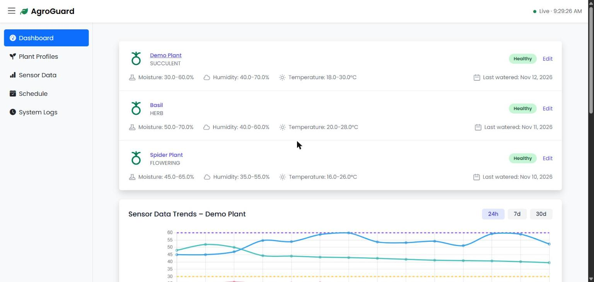
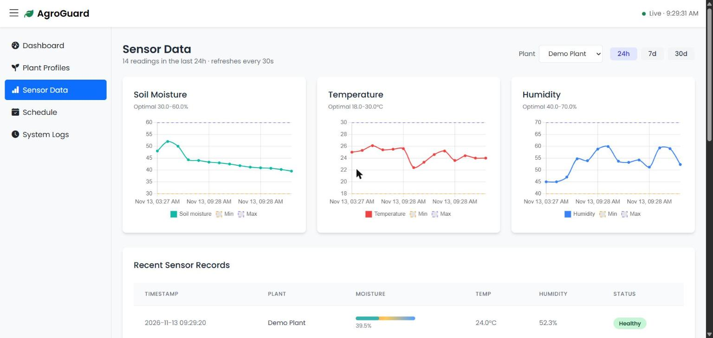
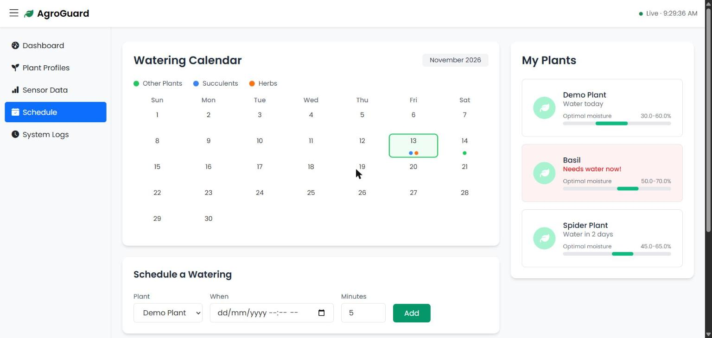

# SmartPlant

[](https://github.com/asteraaaaa/smartPlant/actions/workflows/ci.yml)
[](LICENSE)


A Spring Boot web app for monitoring houseplants and automating their watering.
Sensors report soil moisture, temperature and humidity over a JSON API. When the soil
is too dry, the app switches on a water pump, and everything is shown on a live dashboard.

**It runs out of the box with no hardware.** The pump is mocked and a built-in simulator
produces realistic sensor readings, so you can see the whole system working in a minute.
Hooking it up to a real Arduino-style pump is a one-line configuration change.

> The UI is branded "AgroGuard" in the page header; the project and code are called SmartPlant.
> There is also a separate, simpler repository called [AgroGuard](https://github.com/asteraaaaa/agroGuard),
> built around a real ESP32 (see [Related project](#related-project-agroguard)).

## Screenshots

| Dashboard | Sensor data |
|---|---|
|  |  |

| Watering schedule |
|---|
|  |

## Features

- **Dashboard**: health status per plant (Healthy / Warning / Critical), trend charts for
  24 hours, 7 days or 30 days, and the most recent readings.
- **Sensor data**: per-plant charts for soil moisture, temperature and humidity, with each
  plant's optimal range drawn on the graph.
- **Plant profiles**: add, edit and delete plants with their own optimal ranges, and water
  them manually with one click.
- **Watering schedule**: calendar view, schedule a watering, mark done or delete; due
  schedules run automatically.
- **Auto-watering**: a reading below the plant's minimum moisture triggers the pump, with a
  cooldown so a plant is never watered twice in quick succession.
- **System logs**: a record of pump runs, warnings and plant changes.

## Quick start

You need **JDK 17 or newer** (`JAVA_HOME` must point to it). Maven is included via the wrapper.

```bash
git clone https://github.com/asteraaaaa/smartPlant.git
cd smartPlant
./mvnw spring-boot:run        # macOS / Linux
.\mvnw.cmd spring-boot:run    # Windows (PowerShell or cmd)
```

Then open <http://localhost:8080>.

By default it uses an in-memory H2 database seeded with three demo plants, and the
simulator posts a fake reading for every plant every 10 seconds. Soil dries out over time,
the mock pump waters it, and you can watch it all happen on the dashboard and the
System Logs page.

### Keep your data between restarts

```bash
./mvnw spring-boot:run -Dspring-boot.run.profiles=persist
```

Data is stored under `./data/` (git-ignored) and the database starts empty.

### Run the tests

```bash
./mvnw verify
```

## Using real hardware

1. Turn the demo helpers off and switch the pump to HTTP mode in
   `src/main/resources/application.properties`:

   ```properties
   smartplant.pump.mode=http
   smartplant.pump.url=http://<your-device>/pump/on
   smartplant.simulator.enabled=false
   ```
2. Have your sensor device `POST` readings to `/api/sensors` (see below).
3. When the app decides to water a plant it sends
   `GET <smartplant.pump.url>?duration=<milliseconds>` to your device. If the device can't
   be reached, the failure is logged and the app carries on.

## Configuration

All settings live in `src/main/resources/application.properties`.

| Property | Default | Meaning |
|---|---|---|
| `smartplant.pump.mode` | `mock` | `mock` or `http` (real device) |
| `smartplant.pump.url` | `http://192.168.1.50/pump/on` | Device endpoint, used when mode is `http` |
| `smartplant.pump.timeout-ms` | `2000` | Connect/read timeout when calling the pump |
| `smartplant.pump.duration-ms` | `5000` | How long the pump runs per watering |
| `smartplant.pump.cooldown-seconds` | `300` | Minimum time between automatic waterings of one plant |
| `smartplant.simulator.enabled` | `true` | Generate fake sensor readings (turn off with real sensors) |
| `smartplant.simulator.interval-ms` | `10000` | How often the simulator posts readings |
| `smartplant.scheduler.enabled` | `true` | Run due watering schedules automatically |
| `smartplant.scheduler.interval-ms` | `30000` | How often due schedules are checked |

## Sensor API

```http
POST /api/sensors
Content-Type: application/json

{"plantId": 1, "soilMoisture": 42.5, "temperature": 24.0, "humidity": 55.0}
```

| Status | Meaning |
|---|---|
| `200` | Reading saved |
| `400` | Malformed JSON, or a value out of range |
| `404` | Unknown `plantId` |

A moisture value below the plant's minimum triggers the pump (subject to the cooldown).

Example:

```bash
curl -X POST http://localhost:8080/api/sensors \
  -H "Content-Type: application/json" \
  -d '{"plantId":1,"soilMoisture":12,"temperature":24,"humidity":55}'
```

## Project layout

```
src/main/java/com/csc3700/smartplant/
  controller/   web pages and the sensor API
  service/      business logic: watering, scheduling, sensor ingest, pump clients, simulator
  repository/   Spring Data JPA repositories
  model/        JPA entities (Plant, Sensor, WateringSchedule, SystemLog)
  dto/          request objects for the API
src/main/resources/
  templates/    Thymeleaf pages (Tailwind CSS, Chart.js)
  static/       CSS and JS
  data.sql      demo seed data
src/test/       integration tests (MockMvc)
```

**Tech:** Java 17, Spring Boot 3.5 (Web, Data JPA, Validation, Thymeleaf), H2, Chart.js, Tailwind CSS.

## Related project: AgroGuard

[**AgroGuard**](https://github.com/asteraaaaa/agroGuard) is the simpler version of this project. It was
built to test live telemetry from a real ESP32 sent to a dashboard as JSON, for the CSC3700 group project,
and it also supports starting and stopping the pump from the dashboard. The two are separate projects that
share ideas rather than code.

| | SmartPlant (this repo) | [AgroGuard](https://github.com/asteraaaaa/agroGuard) |
|---|---|---|
| Purpose | Complete plant-care application | Live ESP32 telemetry over JSON, with pump control |
| Plants | Several plant profiles, each with its own ranges | One set of thresholds for the whole server |
| Extras | Watering calendar and schedules, system logs, plant management | Pump command queue, Start/Stop, several devices, API key |
| Pump protocol | The server calls the device (`GET <pump url>?duration=`) | The device polls the server for commands |
| Hardware | Mock pump by default, optional HTTP pump | Built around a real ESP32 |

If you use or build on this work, please credit both repositories. A suggested reference:

> SmartPlant: Spring Boot dashboard for monitoring houseplants and automating watering.
> https://github.com/asteraaaaa/smartPlant. Related project: AgroGuard,
> https://github.com/asteraaaaa/agroGuard.

## Limitations

This is a prototype built for learning and demos:

- **There is no authentication.** Anyone who can reach the server can read data, trigger the
  pump and post readings. Don't expose it to an untrusted network as it is.
- The H2 console is enabled at `/h2-console` (JDBC URL `jdbc:h2:mem:testdb`, user `sa`,
  empty password). Disable it with `spring.h2.console.enabled=false` before deploying anywhere.
- The front end loads Tailwind, Chart.js, Bootstrap and Font Awesome from public CDNs, so the
  UI needs an internet connection.

## License

[MIT](LICENSE)
